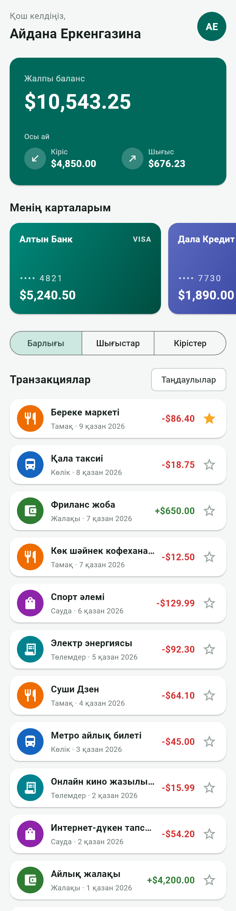
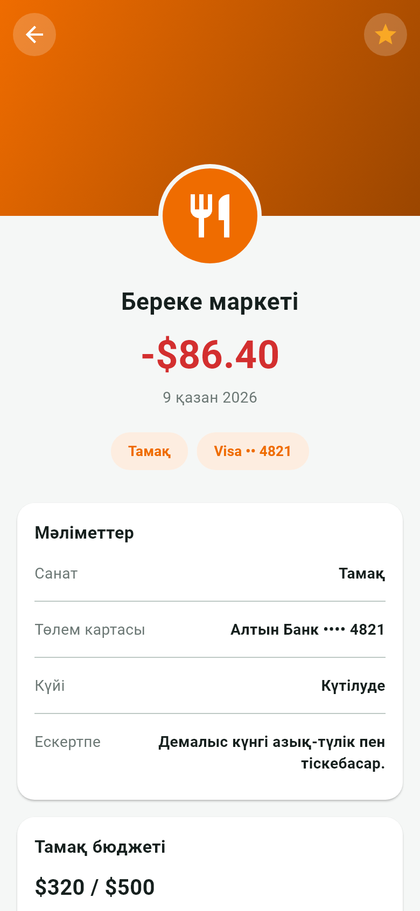
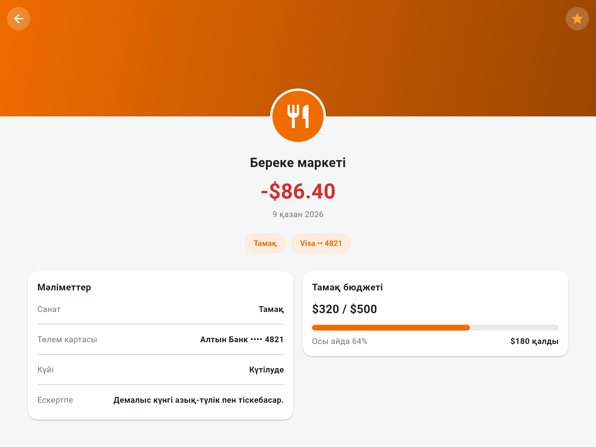

# Pocket

A personal finance and expense tracker built with Flutter, with a Kazakh-language interface and sample data. This is Milestone 1: two screens with local interactivity, no backend and no persistence. The full specification is in [PROJECT_BRIEF.md](PROJECT_BRIEF.md).

| Home | Detail (phone) |
|---|---|
|  |  |

Detail at 1024×768, where the two cards sit side by side:



## What it does

- **Home** shows a greeting, the total balance with this month's income and expenses, a horizontally scrolling row of payment cards, and the transaction list.
- **Type toggle**: `Барлығы` / `Шығыстар` / `Кірістер` (all / expenses / income) filters the list immediately. A `Таңдаулылар` (favorites) chip narrows it to starred transactions, and an empty state appears when nothing matches.
- **Favorites**: tapping a star switches it between outline and filled. The star on the detail screen and the star on the home list always agree.
- **Detail** shows a category-colored banner with the category icon overlapping its bottom edge, the amount, tags, a details card and a budget progress card.

## Running it

```bash
flutter pub get
flutter run
```

Checks:

```bash
flutter analyze
flutter test
dart format --set-exit-if-changed .
```

## Where each requirement is met

| Requirement | Where |
|---|---|
| Feed screen with `Column`, `Row`, `Card` | `HomeScreen` is a scrollable `Column`; `BalanceCard`, `TransactionTile` and the payment cards are `Card`s laid out with `Row`s |
| `Expanded` | Two `Expanded` halves in `BalanceCard`; the title column in `TransactionTile`; the two columns of the wide detail layout |
| `Stack` overlay banner | `DetailBanner`: a `Stack` with `Positioned` back and favorite buttons, and a category icon placed half on the banner and half on the content below |
| Tags | `TagWrap`: a `Wrap` of chips that moves to a second line on narrow screens |
| Responsive layout | `TransactionDetailScreen` uses `LayoutBuilder`: one `Column` under 600 px, a `Row` of two `Expanded` cards from 600 px up |
| `StatefulWidget` + `setState()` | `HomeScreen` (filter, favorites-only, favorite ids) and `TransactionDetailScreen` (its own star) |
| Navigation | `Navigator.push` with `MaterialPageRoute` in `HomeScreen` |

### How favorites stay in sync

`HomeScreen` owns the set of favorite ids. It passes `isFavorite` and an `onToggleFavorite` callback to each tile and to the detail screen. The detail screen keeps a local `_isFavorite` so its star changes instantly, then calls the callback so the home screen updates its own state. No state library is used, only `setState()`.

## Project structure

```
lib/
├── main.dart                  runApp only
├── app.dart                   MaterialApp, theme, home
├── core/
│   ├── constants/             currency symbol, breakpoints, spacing scale
│   ├── theme/                 colors, text styles, Material 3 theme
│   └── utils/formatters.dart  formatMoney(), formatDate()
├── data/
│   ├── models/                Transaction, Category, PaymentCard
│   └── mock/mock_data.dart    12 transactions, 5 categories, 3 cards
└── features/
    ├── home/                  HomeScreen and its widgets
    └── transaction_detail/    TransactionDetailScreen and its widgets
```

The currency symbol is a single constant, `AppConstants.currencySymbol`. The app uses the Flutter SDK only, with no third-party packages.

## Tests

- `test/core/formatters_test.dart`: unit tests for the money and date formatters.
- `test/features/home/home_screen_test.dart`: filtering, star toggling, navigation, favorite sync between screens, the favorites-only chip, and no overflow at 360 and 1024 px.
- `test/features/transaction_detail/transaction_detail_screen_test.dart`: no overflow at 360×800 for every transaction, one column on a phone, two columns at 1024×768, and the star callback.
